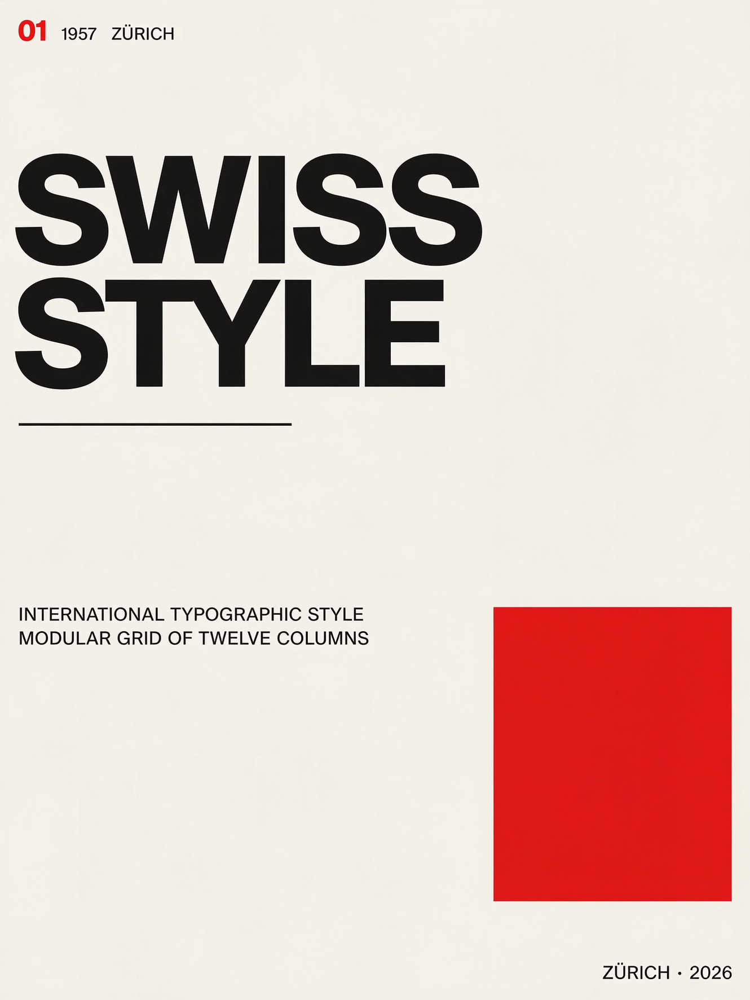
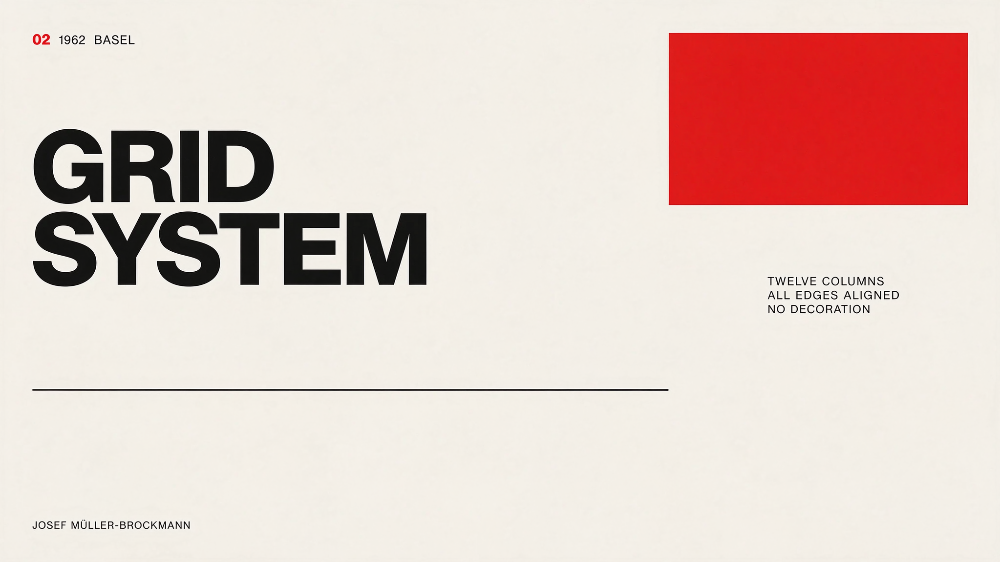
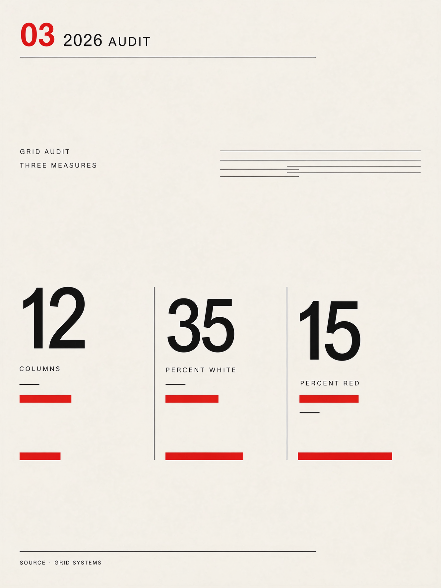
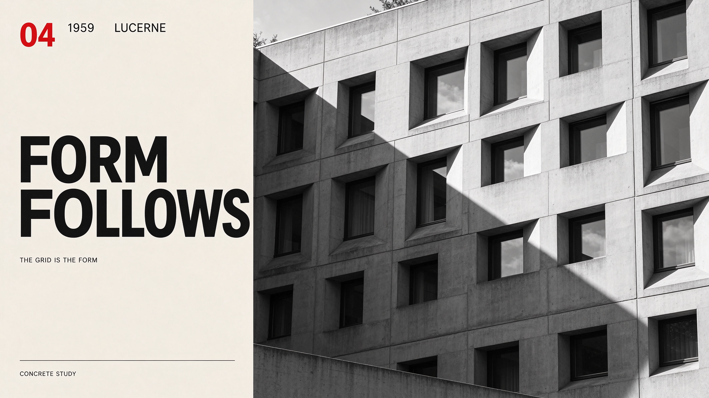

# swiss-style-skill

[中文](README.md) · **English**

> A Swiss Style (International Typographic Style) design skill package for AI.
> Turns the visual grammar of 1950s International Typographic Style into a reusable Skill and ready-to-apply layout specs.

<p>
  
  
  
  
</p>

## Preview

<table>
  <tr>
    <td width="50%"></td>
    <td width="50%"></td>
  </tr>
  <tr>
    <td><sub>01 Vertical poster 3:4 · type-led · index + year/place + oversized headline + tiny body + red anchor</sub></td>
    <td><sub>02 Horizontal cover 16:9 · asymmetric columns · rule spans only 8 columns · single red accent</sub></td>
  </tr>
  <tr>
    <td width="50%"></td>
    <td width="50%"></td>
  </tr>
  <tr>
    <td><sub>03 Data page 3:4 · figure-led · three metrics + red length bars</sub></td>
    <td><sub>04 B/W photo mix 16:9 · scene-led · window rhythm echoes the grid</sub></td>
  </tr>
</table>

All four samples are AI-generated, used to prove the rules are executable: 12-column grid, two-weight contrast, flush left, flat three-color palette, zero decoration. Full prompts and drift reviews live in [`examples/`](examples/).

## Features

- **12-column modular grid**: column width = gutter, solved as `23U`; whitespace ≥ 35%
- **Two-step type scale**: oversized headline + tiny body, ratio ≥ 8, **no intermediate sizes**
- **Two weights only**: Regular and Bold; emphasis comes from scale and position, not weight stacking
- **Flush left everywhere**: ragged right, never centered, never justified
- **Three colors**: black `#000000` / off-white `#F2EFE8` / red `#DA291C`, red area ≤ 15%
- **Flat fill only**: no shadow, gradient, texture, decorative illustration, or 3D
- **Measurable**: 36-item checklist plus a 30-second three-question test

## Repository structure

```
swiss-style-skill/
├── SKILL.md                   Chinese skill definition (entry + six hard rules)
├── SKILL.en.md                English skill definition
├── CHANGELOG.md               Version history
├── references/                Deep specs
│   ├── grid.md                Grid math, coordinate formula, verification
│   ├── typography.md          Weight whitelist, scale ratios, tracking/leading
│   ├── color.md               Three-color roles, red quota, flat-fill bans
│   └── checklist.md           36-item delivery checklist
├── templates/                 Drop-in templates
│   ├── image-prompt.md        6 prompt sets incl. negative prompt
│   ├── poster-layout.md       Vertical poster spec
│   └── cover-layout.md        Horizontal cover and info-page spec
├── examples/                  Real cases: brief → prompt → output → review
│   ├── 01-poster.md
│   ├── 02-cover.md
│   ├── 03-infographic.md
│   └── 04-photo.md
└── assets/                    Four samples
```

## Usage

### 1. As a prompt

1. Open [`templates/image-prompt.md`](templates/image-prompt.md)
2. Copy the template for your case
3. Replace `[scene]` with your subject
4. Paste into any image tool

### 2. As an installable Skill

`SKILL.md` ships with YAML frontmatter (`name` / `description` / `version`) and follows the common skill convention:

```
<skill_root>/swiss-international-style/SKILL.md
```

Keep `references/` and `templates/` beside `SKILL.md` — the skill loads them progressively via links.
Works with Cherry Studio, Coze, and most agent frameworks.

Note: `references/`, `templates/` and `examples/` are written in Chinese, but `SKILL.en.md` is a complete English spec you can load instead.

### 3. As an acceptance spec

Print [`references/checklist.md`](references/checklist.md) and hand it to a designer as the review sheet. It removes most of the "make it bolder / more premium" back-and-forth.

### 4. As a learning reference

Every file in `examples/` includes a decision chain and a drift review, explaining **why** each choice was made — not just what the prompt was.

## Quick example

```
Swiss Style poster, 12-column modular grid, all elements aligned to grid lines
Type: neo-grotesque only, Regular and Bold; oversized headline + tiny body copy
Layout: flush left, ragged right, asymmetric, generous whitespace
Color: black, off-white #F2EFE8, accent red #DA291C only, flat fill
Elements: hairline rules, index 01, year 1924-2024, one red geometric rectangle
Exclude: shadow, gradient, texture, decorative illustration, 3D, icons
```

## Common mistakes

| Mistake | Why it breaks the style |
| :--- | :--- |
| Centered headline | Destroys the flush-left asymmetric grammar |
| Medium / Light weights | Only Regular and Bold allowed |
| Gradient background or shadow | Violates flat-fill principle |
| Illustration, icons, stickers | Decoration is banned |
| Four type sizes | Only two-step contrast allowed |
| Justified text | Must stay ragged right |
| A third or fourth color | Three colors is the ceiling |
| Rounded cards, pill buttons | Contemporary UI language, not Swiss |

## Version

Current **0.2.0** (2026-11-17): restructured specs, English spec, 4 cases, 2 new samples. See [CHANGELOG.md](CHANGELOG.md).

## License

MIT. Free for commercial use, modification, and redistribution.

## Credits

Visual rules derive from Josef Müller-Brockmann's *Grid Systems in Graphic Design* and the Zurich / Basel school practice of the 1950s–60s.
