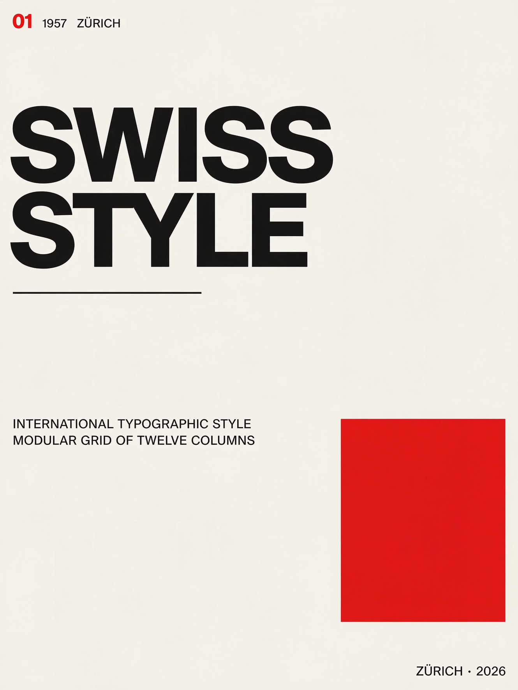
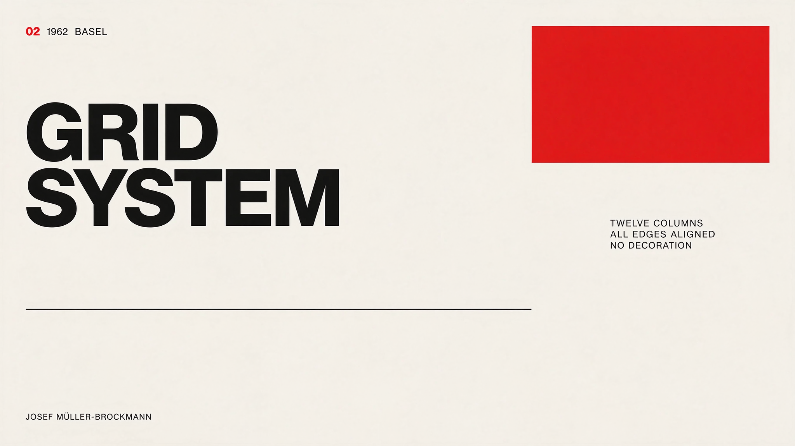

# swiss-style-skill

**中文** · [English](README.en.md)

> 瑞士国际主义风格（Swiss Style / International Typographic Style）AI 设计技能包。
> 把 1950 年代国际主义平面设计的视觉语法，固化成可复用的 Skill 与可套用的版式规范。

<p>
  
  
  
  
</p>

## 效果样张

<table>
  <tr>
    <td width="45%"></td>
    <td width="55%"></td>
  </tr>
  <tr>
    <td><sub>竖版海报 · 3:4 · 编号 + 年份地点 + 极大标题 + 极小正文 + 红色几何锚点</sub></td>
    <td><sub>横版封面 · 16:9 · 不对称分栏 + 细线分隔 + 单点强调红</sub></td>
  </tr>
</table>

两张样张均为 AI 生成成品，用于验证这套规则的可执行性：12 栏网格、双字重强对比、左对齐、三色平涂、零装饰。

## 核心特性

- **12 栏模块化网格**：所有元素边缘严格对齐网格线，不对称构图，留白 ≥ 35%
- **新怪诞无衬线字体**：Helvetica / Neue Haas Grotesk / Inter，只用 Regular 与 Bold 两种字重
- **强字号对比**：超大标题 + 极小正文，差距 ≥ 4 倍，拒绝中间字号过渡
- **统一左对齐**：右侧参差不齐（ragged right），不居中、不两端对齐
- **三色体系**：纯黑 `#000000` / 米白 `#F2EFE8` / 强调红 `#DA291C`，红色面积 ≤ 15%
- **纯平涂**：无阴影、无渐变、无纹理、无装饰插画、无 3D
- **克制的点缀系统**：极细线、`01` `02` 编号、小号年份与地点

## 文件说明

| 文件 | 用途 |
| :--- | :--- |
| `SKILL.md` | 完整技能定义：强制准则、网格规格、版式层级、校验清单、常见错误表 |
| `templates/image-prompt.md` | AI 生图提示词模板（通用 / 竖版海报 / 横版封面 / 信息图 / 摄影混合 / 反向提示词） |
| `templates/poster-layout.md` | 竖版海报版式规范：网格坐标、5 层结构、3 类构图 |
| `templates/cover-layout.md` | 横版封面与信息页版式规范：层级、构图、多页连续性 |
| `assets/` | 风格样张（竖版海报 / 横版封面） |
| `LICENSE` | MIT 开源协议 |

## 使用方式

### 一、直接当提示词用

1. 打开 `templates/image-prompt.md`
2. 复制对应场景的模板
3. 把 `[场景]` 替换成你的主题（如：平面设计百年展海报）
4. 粘贴到任意生图工具

### 二、作为 Skill 接入 AI 客户端

`SKILL.md` 带 YAML frontmatter（`name` / `description`），符合通用 Skill 规范，可直接放入支持自定义 Skill 的客户端技能目录：

```
<skill_root>/swiss-international-style/SKILL.md
```

例如 Cherry Studio、扣子 Coze、各类 Agent 框架的自定义技能目录。

### 三、作为设计交付规范

把 `SKILL.md` 的校验清单当作验收标准，交给设计师或设计外包时直接附上，可显著减少来回修改。

## 快速示例

```
瑞士国际主义风格，平面设计百年展览海报，12 栏模块化网格系统
字体：新怪诞无衬线体，仅常规与粗体；超大号标题与极小号正文强对比
排版：全部左对齐，右侧不齐，不对称构图，大面积留白
色彩：纯黑、米白、强调红 #DA291C，全部平涂
元素：细实线分隔，01 编号，1924–2024 年份，单块红色几何矩形
排除：阴影、渐变、纹理、装饰插画、3D、图标
```

## 常见错误（生成后对照检查）

| 错误 | 为什么不行 |
| :--- | :--- |
| 标题居中 | 破坏左对齐不对称语法 |
| 用了 Medium / Light 字重 | 只允许 Regular 与 Bold |
| 加了渐变背景、投影 | 违反平涂原则 |
| 出现插画、图标、贴纸 | 违反禁用装饰 |
| 四级字号（大 / 中 / 小 / 微） | 只能强对比两级 |
| 全文两端对齐 | 必须 ragged right |
| 加入第三、第四种颜色 | 三色封顶 |

## 开源协议

MIT License，可自由商用、修改、再分发。

## 致谢

视觉规则源自 Josef Müller-Brockmann《Grid Systems in Graphic Design》与 1950–60 年代苏黎世 / 巴塞尔学派的平面设计实践。
