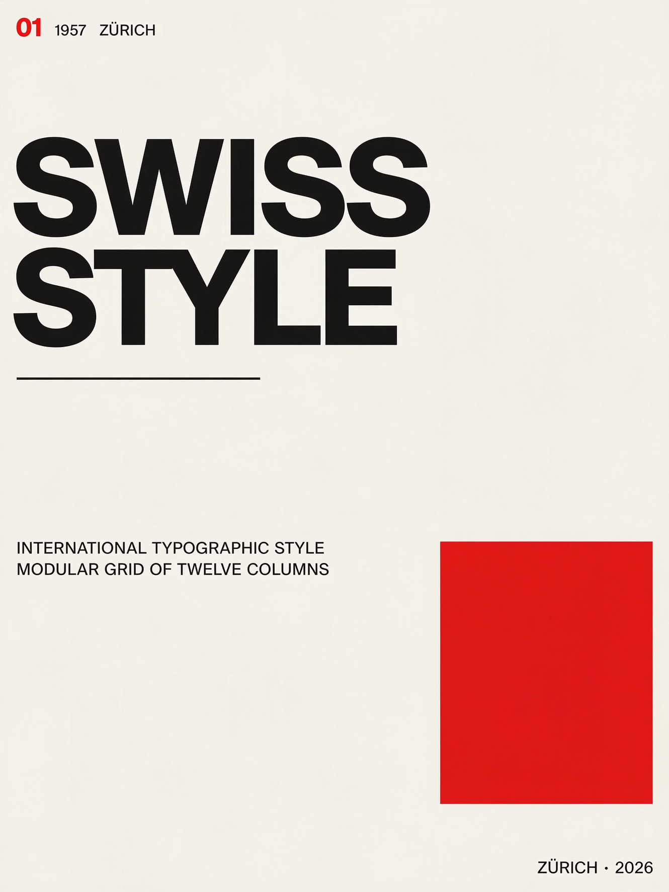

# 案例 01 · 竖版海报「SWISS STYLE」



## 1. 原始需求

> 做一张能代表瑞士风格的海报样张，3:4 竖版，要能一眼看出是国际主义风格。

## 2. 决策链

| 决策点 | 选择 | 依据 |
| :--- | :--- | :--- |
| 主导关系 | 字体主导 | 内容是风格本身，没有摄影主体 |
| 画幅 | 3:4，1200×1600 | 竖版海报默认，社交也通用 |
| 字号层级 | 极大标题 + 极小正文 | 唯一合法层级 |
| 视觉锚点 | 一块红矩形 | 只用 1 个锚点，避免多点竞争 |
| 文案长度 | 标题 2 词，正文 2 行 | 留白需要呼吸空间 |

## 3. 完整提示词

```
瑞士国际主义风格竖版设计海报，米白色 #F2EFE8 平涂底色，12 栏模块化网格，
所有元素边缘严格对齐网格线。左上角极小号信息行：文字“01”用强调红 #DA291C 粗体，
其后依次为文字“1957”与“ZÜRICH”黑色常规体。中上部超大号主标题分两行：
第一行“SWISS”，第二行“STYLE”，黑色粗体新怪诞无衬线体，跨 6 栏宽度，
左边缘对齐最左栏线，字距收紧，行距紧凑。标题下方一条极细黑色实线横贯 4 栏。
中部偏下极小号正文两行：“INTERNATIONAL TYPOGRAPHIC STYLE”与
“MODULAR GRID OF TWELVE COLUMNS”，黑色常规体，左对齐，右侧参差不齐。
右侧中下部一块纯红 #DA291C 实心矩形色块，直角无圆角，边缘贴合网格线。
右下角极小号“ZÜRICH · 2026”。全部平涂填色，无阴影、无渐变、无纹理、无噪点、
无装饰插画、无图标、无 3D。不对称构图，大面积留白，留白占比超过 40%，
视觉重心偏上偏左，理性克制精确。
```

## 4. 复盘

**做对的**：标题两级字号对比到位；红色只有编号和一块矩形；正文两行短、左对齐、留白充足；细线只贯穿 4 栏不铺满，符合"局部强调"。

**偏差**：AI 生成的红块比理想位置略偏右下，且标题与正文之间的空白略少——真实设计稿应把正文上移 2 个基线单位。

**结论**：可作为"字体主导型瑞士海报"的基准模板，替换标题与元信息即可复用。
