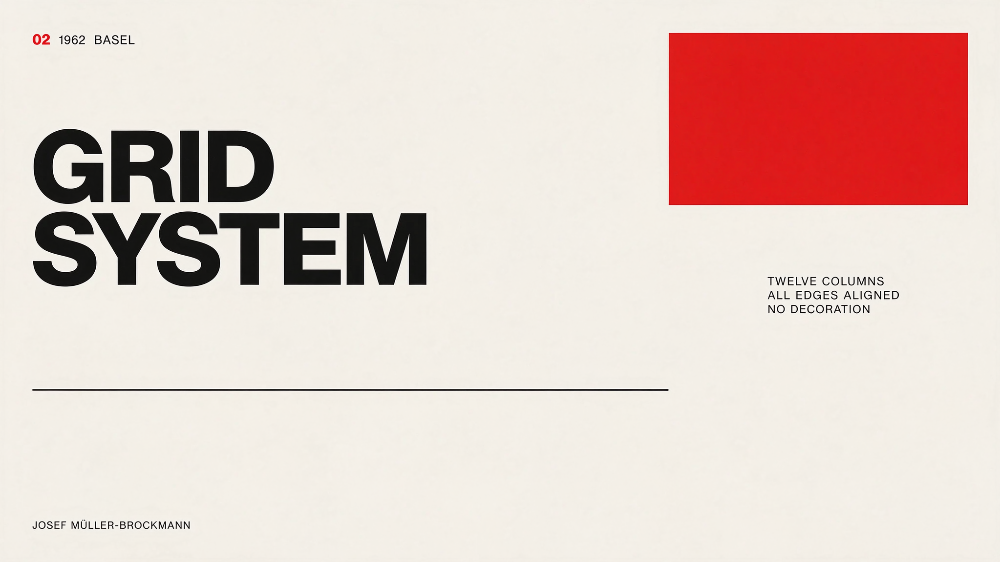

# 案例 02 · 横版封面「GRID SYSTEM」



## 1. 原始需求

> 要一张横版封面，用在报告或演示首页，要有"系统感"。

## 2. 决策链

| 决策点 | 选择 | 依据 |
| :--- | :--- | :--- |
| 主导关系 | 字体主导 + 红块辅助 | 封面不需要摄影 |
| 画幅 | 16:9，1600×900 | 演示/视频封面通用 |
| 分栏 | 左 5 栏标题 / 右 3 栏正文 | 7:5 不对称，避免五五分 |
| 细线 | 贯穿 1–8 栏 | 不到全宽，保留右侧呼吸 |
| 锚点 | 右上单块红矩形 | 与左下标题形成对角张力 |

## 3. 完整提示词

```
瑞士国际主义风格横版封面设计，米白色 #F2EFE8 平涂底色，12 栏模块化网格，
所有元素边缘严格对齐网格线，不对称构图。左上角极小号信息行：文字“02”用强调红
#DA291C 粗体，其后为文字“1962”与“BASEL”黑色常规体。左侧超大号主标题分两行：
第一行“GRID”，第二行“SYSTEM”，黑色粗体新怪诞无衬线体，跨 5 栏，左边缘对齐最左栏线，
字距收紧，行距紧凑。右侧极小号正文三行：“TWELVE COLUMNS”“ALL EDGES ALIGNED”
“NO DECORATION”，黑色常规体，左对齐，右侧参差不齐。右上角一块纯红 #DA291C 实心矩形
色块，直角无圆角，边缘贴合网格线。中下部一条极细黑色实线横贯第 1 至第 8 栏。
左下角极小号“JOSEF MÜLLER-BROCKMANN”。全部平涂，无阴影、无渐变、无纹理、
无装饰插画、无图标、无 3D。大面积留白，留白占比超过 35%，视觉重心偏左，理性克制精确。
```

## 4. 复盘

**做对的**：标题与正文的栏宽差距明显；三步信息（编号 / 标题 / 正文）视线顺序清晰；细线只走 8 栏，右侧留白成立。

**偏差**：红块面积略大，接近 18%，超出 15% 上限；正文三行右边缘不齐程度不够明显。

**改进**：把红块宽度缩到 2 栏高、3 栏宽；正文行宽收到 3 栏以增强参差感。

**结论**：适合作为"报告/白皮书封面"模板，红块尺寸参数需按 15% 上限回收。
