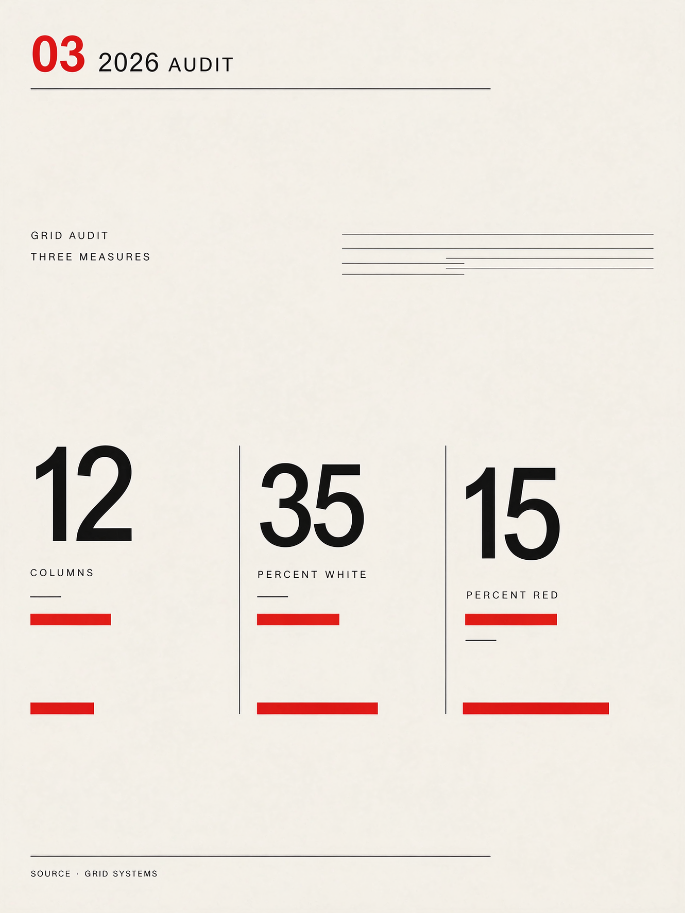

# 案例 03 · 数据页「GRID AUDIT」



## 1. 原始需求

> 做一页数据信息图，要展示三个指标：12 栏、35% 留白、15% 红。仍然保持瑞士风格。

## 2. 决策链

| 决策点 | 选择 | 依据 |
| :--- | :--- | :--- |
| 主导关系 | 成果数字主导 | 数据页的核心是数字本身 |
| 结构 | 3 块横排，各 3–4 栏 | 3×4 = 12，正好吃满网格 |
| 分隔 | 2 条极细竖线 | 用线不用卡片，避免容器化 |
| 比例表达 | 红色短条，长度递增 | 用长度编码，不用饼图和渐变条 |
| 字号 | 数字极大 Bold / 标签极小 Regular | 两级对比最大化 |

## 3. 完整提示词

```
瑞士国际主义风格数据信息图，竖版，米白色 #F2EFE8 平涂底色，12 栏模块化网格，
所有元素边缘严格对齐网格线。左上角：文字“03”用强调红 #DA291C 粗体，
其后为文字“2026”与“AUDIT”黑色常规体。中上部极小号两行标题：“GRID AUDIT”与
“THREE MEASURES”，黑色常规体，左对齐。中下部三个数据块横向并列，各跨 3 至 4 栏，
用极细黑色实线分隔：第一块极大数字“12”黑色粗体配极小标签“COLUMNS”；
第二块极大数字“35”配极小标签“PERCENT WHITE”；第三块极大数字“15”配极小标签
“PERCENT RED”。三块数据底部各有一条纯红 #DA291C 实心矩形短条表示比例，
长度严格递增，直角无圆角。底部一条极细黑线横贯 8 栏，左下角极小号
“SOURCE · GRID SYSTEMS”。全部平涂，无阴影、无渐变、无纹理、无装饰插画、
无图标、无 3D。不对称构图，大面积留白，理性精确。
```

## 4. 复盘

**做对的**：三级数字与极小标签对比强烈；竖线分隔而非卡片容器，正确；红条只做长度编码，没加圆角。

**偏差**：三根红条长度差异不够明显（应该 35 明显长于 15）；右上出现了一组多余短细线，属于模型自行添加的装饰。

**改进**：提示词里直接写死"红条长度比例为 12 : 35 : 15，第三根最短"，并追加"页面只允许 3 条竖分隔线与 1 条底部横线，不得出现其他线条"。

**结论**：数据页是这类模型最容易"自由发挥"的场景，必须把线条数量与比例写死。
