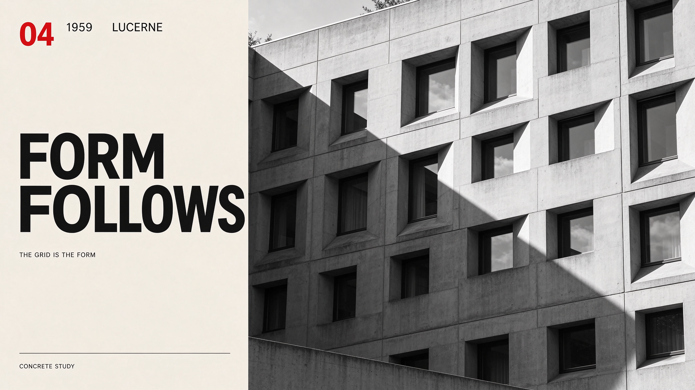

# 案例 04 · 黑白摄影混合「FORM FOLLOWS」



## 1. 原始需求

> 要一张带照片的海报，照片必须是黑白的，而且照片本身看起来就要像有网格。

## 2. 决策链

| 决策点 | 选择 | 依据 |
| :--- | :--- | :--- |
| 主导关系 | 场景主导 | 照片的重复窗洞本身就是网格，与主题同构 |
| 分栏 | 照片右 7 栏 / 文字左 5 栏 | 7:5 不对称 |
| 照片属性 | 高对比黑白、直射光、无噪点 | 只允许黑白摄影，且不能有滤镜感 |
| 文字位置 | 左栏起线，压到照片边缘前 1 栏 | 文字与图不重叠，但共享同一网格 |
| 文案 | 标题 2 词 + 正文 1 行 | 照片已承担主要信息，文字只做点题 |

## 3. 完整提示词

```
瑞士国际主义风格摄影海报，横版，12 栏模块化网格。画面右侧 7 栏为一张高对比黑白建筑摄影：
混凝土清水模立面，规则排列的方形窗洞形成重复网格，硬朗直射光，强烈明暗分割，
无滤镜噪点，边缘严格对齐网格线并顶到页边。左侧 5 栏为米白色 #F2EFE8 平涂区域，放置文字。
左上角：文字“04”用强调红 #DA291C 粗体，其后为文字“1959”与“LUCERNE”黑色常规体。
左侧中部超大号主标题分两行：第一行“FORM”，第二行“FOLLOWS”，黑色粗体新怪诞无衬线体，
左对齐至栏线，字距收紧。标题下方极小号正文：文字“THE GRID IS THE FORM”黑色常规体。
左下角一条极细黑色实线横贯 4 栏，其下一行极小号“CONCRETE STUDY”。全部平涂文字与色块，
无阴影、无渐变、无纹理叠加、无装饰插画、无图标、无 3D。不对称构图，理性克制。
```

## 4. 复盘

**做对的**：照片是真正的黑白高对比，没有彩色泄漏；窗洞的重复节奏与 12 栏同频，属于"内容即网格"；文字区干净，红编号落在照片边界外。

**偏差**：`FORM FOLLOWS` 的 S 被照片边缘轻微切到，字距收紧过头；照片左上角天空区域偏灰，对比度还能再拉。

**改进**：提示词增加"标题右边界距照片左缘至少保留 1 栏间距"，并指定"照片最亮部接近纯白、最暗部接近纯黑"。

**结论**：摄影混合型是瑞士风格里最有说服力的一类，关键是"照片的几何秩序要与网格同构"，而不是随便放一张黑白图。
